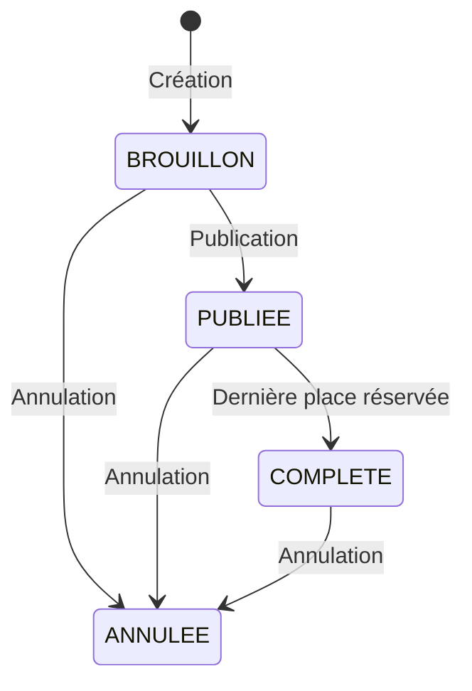
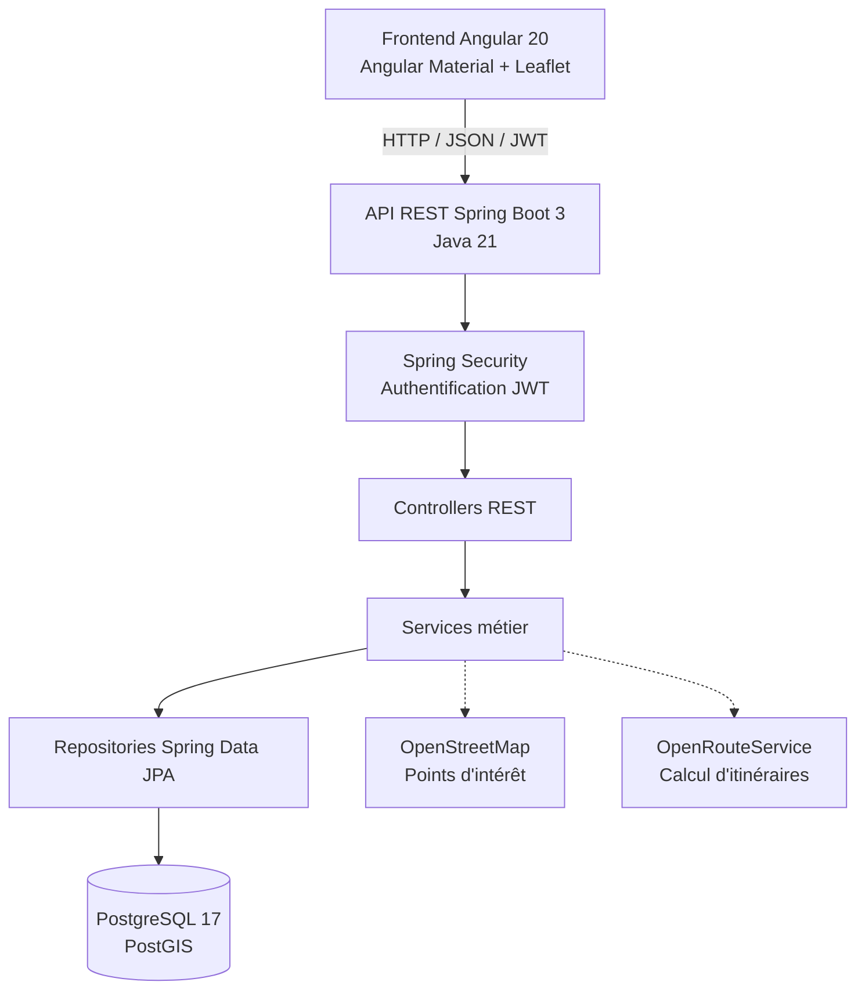

# RoadMoto — organisation de balades moto en Suisse


Plateforme permettant à un motard de proposer une balade et aux autres de s'y inscrire,
avec gestion des places, des états de la sortie et des points d'intérêt géolocalisés.

> 🚧 **Projet en cours de développement.** Le backend (authentification, sorties,
> participations) est fonctionnel et testé. Les itinéraires, l'assistant d'itinéraire
> et le frontend Angular sont en cours. Voir [Feuille de route](#feuille-de-route).

---

## Le problème

Les applications existantes (Kurviger, Calimoto, WeRide) excellent en navigation et en
planification d'itinéraires, mais traitent l'organisation collective en second plan.
Elles ignorent une contrainte propre aux cols de montagnes : leur ouverture. En début
et en fin de saison typiquement d'avril à juin, puis en octobre, savoir quels cols
sont praticables conditionne directement le choix d'un itinéraire, et l'information
est dispersée entre plusieurs sources.

RoadMoto se concentre sur cet angle : **la sortie de groupe**, avec les règles qui vont
avec, et un contexte géographique suisse.

---

## Fonctionnalités

**Implémenté**

- Inscription et authentification par JWT (access token, mots de passe hachés en BCrypt)
- Création d'une sortie : titre, date, point de départ géolocalisé, niveau, places
- Machine à états : `BROUILLON` → `PUBLIEE` → `COMPLETE` / `ANNULEE`
- Inscription avec les règles métier du domaine
- Inscription automatique de l'organisateur à la création
- Calcul des places restantes

**En cours**

- Import des points d'intérêt depuis OpenStreetMap (cols, restaurants, points de vue)
- Calcul d'itinéraires via OpenRouteService
- Assistant d'itinéraire en langage naturel
- Interface Angular avec cartographie
- Désincription à une sortie

---

## Règles métier

Le cœur du projet n'est pas le CRUD mais les invariants du domaine :

| Règle | Comportement |
|---|---|
| Sortie non publiée | Inscription refusée (`409`) |
| Sortie déjà partie | Inscription refusée (`409`) |
| Double inscription | Refusée — vérification applicative **et** contrainte d'unicité en base |
| Dernière place prise | Passage automatique en `COMPLETE` |
| Modification ou publication | Réservée à l'organisateur (`403`) |
| Organisateur | Inscrit d'office, ne peut pas se désister (doit annuler la sortie) |

Chacune fait l'objet d'un test, cas nominal et cas d'erreur.

### Cycle de vie d'une sortie



Ce diagramme représente les principales transitions documentées. Les transitions effectives restent contrôlées par les règles du service métier.

---

## Stack

| Couche | Technologies |
|---|---|
| Backend | Java 21, Spring Boot 3, Spring Security (JWT), Spring Data JPA |
| Base de données | PostgreSQL 17 + PostGIS, migrations Flyway |
| Tests | JUnit 5, AssertJ, Testcontainers |
| Frontend | Angular 20 (standalone, signals), Angular Material, Leaflet *(à venir)* |
| Infrastructure | Docker Compose, GitHub Actions |

---

## Décisions techniques

Les choix ci-dessous sont ceux qui méritent une explication ; le reste suit les
conventions Spring Boot.

**Flyway avec `ddl-auto: validate`, jamais `update`**
Le schéma est du code versionné. Hibernate ne modifie jamais la base : il vérifie que
les entités correspondent au schéma et refuse de démarrer sinon. Cette rigueur a détecté
plusieurs divergences de nommage avant qu'elles n'atteignent la production.

**PostGIS plutôt qu'un calcul de distance applicatif**
Les positions sont stockées en `geography(Point, 4326)` avec un index GIST. Les
recherches par proximité utiliseront `ST_DWithin`, qui exploite l'index là où un calcul
de Haversine en Java imposerait un parcours complet de la table.

**Testcontainers plutôt qu'une base H2**
Les tests s'exécutent contre un vrai PostgreSQL avec PostGIS, la même image qu'en
développement. H2 ne supporte pas les types géographiques et diverge sur les contraintes,
ce qui aurait rendu les tests non représentatifs.

**Défense en profondeur sur les règles d'intégrité**
La vérification de doublon existe à la fois dans le service et comme contrainte
`UNIQUE` en base. Le service produit une erreur métier lisible dans le cas normal ;
la contrainte garantit l'intégrité même en cas d'accès concurrents entre la lecture
et l'écriture.

**Contrôle de capacité sous verrou pessimiste**
La vérification du nombre de places et l'insertion de la participation s'exécutent
sous un verrou `PESSIMISTIC_WRITE` sur la sortie. Deux inscriptions simultanées sur
les dernières places sont ainsi sérialisées, ce qu'un simple contrôle applicatif ne
garantit pas.

**Authentification sans état**
Aucune session serveur : le token porte l'identité. L'API passe ainsi à l'échelle
horizontalement. Contrepartie assumée : un token ne peut pas être révoqué avant son
expiration, d'où une durée de vie courte.

**DTO distincts des entités**
Les entités ne sortent jamais de la couche service. Les DTO de requête excluent les
champs décidés par le serveur (rôle, statut, organisateur), ce qui ferme la porte à
l'élévation de privilèges par le corps de la requête. Les DTO de réponse excluent les
données sensibles, l'organisateur d'une sortie publique est exposé par son pseudo,
jamais par son email.

---

## Lancer le projet en local

**Prérequis** : Java 21, Docker, Maven.

```bash
# 1. Base de données
docker compose up -d

# 2. Application
./mvnw spring-boot:run
```

L'API écoute sur `http://localhost:8081`.
Flyway crée le schéma au premier démarrage.

### Configuration

| Variable | Défaut | Description |
|---|---|---|
| `JWT_SECRET` | clé de développement | Clé de signature HS256, encodée en Base64 |
| `JWT_EXPIRATION_MS` | `86400000` | Durée de validité du token (24 h) |

> La clé présente dans `application.yml` est une clé de développement sans valeur.
> En production, `JWT_SECRET` est fourni par l'environnement.

### Documentation de l'API

Swagger UI : `http://localhost:8081/swagger-ui.html`

---

## Tests

```bash
./mvnw verify
```

Les tests d'intégration démarrent un conteneur PostGIS via Testcontainers —
Docker doit être en cours d'exécution. Aucune base préexistante n'est nécessaire.

La CI exécute la même commande sur chaque pull request.

---

## Limites connues

- Le mapping d'une sortie exécute une requête `COUNT` pour les places restantes.
  Acceptable sur une ressource unique, à optimiser par une requête agrégée sur le
  listing (problème N+1).
- Pas de refresh token : l'utilisateur doit se reconnecter à l'expiration.
- Les fermetures saisonnières des cols sont saisies manuellement, sans source
  officielle automatisée.

---

## Feuille de route

- [x] Authentification JWT et gestion des comptes
- [x] Sorties : création, publication, machine à états
- [x] Participations et règles d'inscription
- [x] Intégration continue
- [ ] Import des POI depuis OpenStreetMap (canton pilote : Valais)
- [ ] Calcul d'itinéraires et mise en cache
- [ ] Assistant d'itinéraire à sortie JSON structurée
- [ ] Interface Angular
- [ ] Déploiement

---

## Ce que je ferais différemment

**Séparer l'authentification de la gestion des comptes dès le départ.** `UtilisateurService`
porte aujourd'hui l'inscription et la délivrance de tokens, deux responsabilités qui
auraient mérité deux services.

**Introduire un UserDetails personnalisé portant l'identifiant.** Chaque requête
authentifiée recharge l'utilisateur depuis la base pour obtenir son id. Un `UserDetails`
métier, combiné à `getReferenceById`, éviterait cet aller-retour.

**Modéliser la machine à états explicitement.** Les transitions sont vérifiées par des
`if` dans le service. Une méthode `peutPasserA(Statut)` sur l'entité rendrait les règles
plus lisibles et testables isolément.

---

## Données et licences

Les données géographiques proviennent d'[OpenStreetMap](https://www.openstreetmap.org/copyright)
(© OpenStreetMap contributors, ODbL). Les fonds de carte proviennent de
[swisstopo](https://www.geo.admin.ch).

Projet de démonstration, développé dans un cadre de portfolio.


# RoadMoto — Organisation de balades moto en Suisse


**RoadMoto** est une plateforme web d'organisation de balades moto en Suisse. Elle permet aux motards de proposer des sorties, de gérer les inscriptions et, à terme, de préparer des itinéraires intégrant des points d'intérêt géolocalisés.

Le projet met l'accent sur les **règles métier des sorties de groupe**, la **gestion des inscriptions concurrentes** et les spécificités géographiques de la Suisse, notamment l'accessibilité saisonnière des cols alpins.

> 🚧 **Projet en cours de développement.** Le backend (authentification, sorties et participations) est fonctionnel et testé. Les itinéraires, l'assistant d'itinéraire et le frontend Angular sont en cours de développement.

## Le problème

Les applications comme Kurviger, Calimoto et WeRide proposent des fonctionnalités de navigation et de planification d'itinéraires. RoadMoto adopte une approche différente : placer **l'organisation collective d'une balade** au centre de l'application.

Une sortie de groupe implique plusieurs contraintes :
- Limiter le nombre de participants.
- Empêcher les doubles inscriptions.
- Réserver certaines actions à l'organisateur.
- Gérer les changements de statut d'une sortie.
- Préserver la cohérence des inscriptions en cas d'accès concurrents.

En Suisse, une difficulté supplémentaire intervient lors de la préparation des itinéraires : **l'ouverture saisonnière des cols alpins**.

Au printemps et en automne, certains cols peuvent être fermés ou soumis à des restrictions. Cette information influence directement le choix du parcours et reste répartie entre plusieurs sources.

RoadMoto vise à réunir l'organisation des sorties et la préparation d'itinéraires dans une même plateforme.

## Fonctionnalités

### Implémentées

- Inscription et authentification avec JWT.
- Hachage des mots de passe avec BCrypt.
- Création de sorties : titre, date, départ géolocalisé, niveau et capacité.
- Gestion des statuts : `BROUILLON`, `PUBLIEE`, `COMPLETE`, `ANNULEE`.
- Publication et modification réservées à l'organisateur.
- Inscription et désinscription des participants.
- Inscription automatique de l'organisateur à sa propre sortie.
- Calcul du nombre de places restantes.
- Validation des règles métier et gestion des erreurs HTTP.

### En cours de développement

- Import de points d'intérêt depuis OpenStreetMap : cols, restaurants et points de vue.
- Calcul d'itinéraires via OpenRouteService.
- Assistant d'itinéraire utilisant le langage naturel.
- Interface Angular avec cartographie Leaflet.
- Gestion des informations d'ouverture et de fermeture des cols.

## Stack technique

| Couche | Technologies |
|---|---|
| Backend | Java 21, Spring Boot 3 |
| Sécurité | Spring Security, JWT, BCrypt |
| Persistance | Spring Data JPA, Hibernate |
| Base de données | PostgreSQL 17, PostGIS |
| Migrations | Flyway |
| Tests | JUnit 5, AssertJ, Testcontainers |
| Frontend (en cours) | Angular 20, TypeScript, Angular Material, Leaflet |
| Infrastructure | Docker Compose, GitHub Actions |
| Services géographiques prévus | OpenStreetMap, OpenRouteService, swisstopo |

## Architecture

L'application suit une architecture en couches, avec une API REST Spring Boot séparée du frontend Angular.

Le diagramme présente l'architecture cible. Le frontend et les intégrations de calcul d'itinéraires ne sont pas encore finalisés.



Les controllers exposent les endpoints REST, les services appliquent les règles métier et les repositories assurent l'accès aux données.

Les entités JPA ne sont pas exposées directement par l'API : les échanges utilisent des DTO dédiés.

## Règles métier

Le cœur du backend ne repose pas uniquement sur des opérations CRUD, mais sur des **invariants métier** qui garantissent la cohérence des sorties et des participations.

| Règle | Comportement |
|---|---|
| Sortie non publiée | Inscription refusée (`409 Conflict`) |
| Sortie déjà commencée | Inscription refusée (`409 Conflict`) |
| Double inscription | Refusée par le service et une contrainte d'unicité en base |
| Dernière place réservée | Passage automatique au statut `COMPLETE` |
| Modification ou publication | Réservée à l'organisateur (`403 Forbidden`) |
| Organisateur | Inscrit automatiquement et ne peut pas se désinscrire |
| Annulation par l'organisateur | Utilisation de la procédure d'annulation de la sortie |

Les règles font l'objet de tests couvrant les cas nominaux et les cas d'erreur.

### Cycle de vie d'une sortie


Ce diagramme représente les principales transitions documentées. Les transitions effectives restent contrôlées par les règles du service métier.

## Décisions techniques

### 1. Flyway et validation du schéma

**Choix :** migrations Flyway avec `spring.jpa.hibernate.ddl-auto=validate`, plutôt que `update`.

Le schéma de base de données est versionné et modifié uniquement par des migrations explicites.

Hibernate vérifie la cohérence entre les entités et le schéma sans le modifier automatiquement.

Cette approche permet :
- De suivre les évolutions du modèle de données.
- De rendre les migrations reproductibles.
- De détecter certaines divergences entre le code et la base.
- D'éviter les modifications implicites du schéma au démarrage.

### 2. PostGIS pour les données géographiques

**Choix :** PostgreSQL avec l'extension PostGIS.

Les coordonnées géographiques sont stockées en `geography(Point, 4326)`, avec un index spatial GiST.

Les recherches par proximité utiliseront notamment `ST_DWithin`.

Cette fonction peut exploiter l'index spatial, contrairement à un calcul de distance réalisé en Java après chargement de toutes les positions.

PostGIS permet de conserver les traitements géographiques au niveau de la base de données.

### 3. Testcontainers plutôt qu'une base H2

**Choix :** exécuter les tests d'intégration avec PostgreSQL et PostGIS dans un conteneur Docker.

Une base H2 en mémoire ne reproduirait pas fidèlement :
- Les types géographiques PostGIS.
- Certaines contraintes SQL.
- Le comportement spécifique de PostgreSQL.
- Les migrations exécutées sur la base cible.

Testcontainers permet donc de tester l'application dans un environnement plus représentatif de celui utilisé en développement.

### 4. Défense en profondeur sur les inscriptions

**Choix :** contrôler les doubles inscriptions à deux niveaux.

Le service vérifie qu'un utilisateur n'est pas déjà inscrit à la sortie et renvoie une erreur métier explicite.

Une contrainte `UNIQUE` en base de données garantit également l'unicité, même lorsque deux requêtes concurrentes passent la vérification applicative avant l'insertion.

La validation métier améliore l'expérience utilisateur ; la contrainte SQL protège l'intégrité des données.

### 5. Verrouillage optimiste des inscriptions

**Choix :** utiliser `@Version` sur l'entité `Sortie`.

Lorsque plusieurs utilisateurs tentent de réserver simultanément les dernières places, le verrouillage optimiste permet de détecter les modifications concurrentes.

Le contrôle de capacité et les modifications concernées doivent s'effectuer dans une transaction cohérente, avec une gestion appropriée des conflits de version.

L'objectif est d'empêcher que des inscriptions concurrentes aboutissent à un dépassement de la capacité autorisée.

### 6. Authentification JWT sans session serveur

**Choix :** authentification stateless avec Spring Security et JWT.

L'identité de l'utilisateur est portée par un token signé. Le serveur ne conserve pas de session HTTP d'authentification.

Cette architecture facilite la mise à l'échelle horizontale du backend.

**Compromis :** aucun mécanisme de révocation anticipée des access tokens n'est actuellement prévu. Leur durée de validité doit donc être adaptée au contexte de déploiement.

### 7. Séparation entre entités et DTO

**Choix :** utiliser des DTO pour les requêtes et les réponses de l'API.

Les DTO de requête n'exposent pas les champs dont la valeur doit être déterminée par le serveur, notamment :
- Le rôle de l'utilisateur.
- Le statut initial d'une sortie.
- L'identité de l'organisateur.

Les DTO de réponse limitent les données exposées. Par exemple, l'organisateur d'une sortie publique est identifié par son pseudo plutôt que par son adresse email.

Cette séparation réduit le couplage entre l'API et le modèle de persistance et contribue à limiter les risques de modification non autorisée des champs.

## Installation locale

### Prérequis

- Java 21
- Docker et Docker Compose
- Maven ou le Maven Wrapper inclus dans le projet

### 1. Démarrer la base de données

```bash
docker compose up -d
```

### 2. Démarrer le backend

Sous Linux ou macOS :

```bash
./mvnw spring-boot:run
```

Sous Windows :

```powershell
.\mvnw.cmd spring-boot:run
```

L'API est accessible à l'adresse :

**http://localhost:8081**

Au premier démarrage, Flyway exécute les migrations nécessaires à l'initialisation du schéma.

### Configuration

| Variable | Valeur par défaut | Description |
|---|---|---|
| `JWT_SECRET` | Clé de développement | Secret de signature HS256 encodé en Base64 |
| `JWT_EXPIRATION_MS` | `86400000` | Durée de validité du token, soit 24 heures |

> **Sécurité :** la clé fournie dans la configuration locale est destinée uniquement au développement. En production, `JWT_SECRET` doit être fourni par l'environnement avec une valeur forte et confidentielle. La durée de validité des tokens devra également être réévaluée.

### Documentation de l'API

Swagger UI est disponible à l'adresse :

**http://localhost:8081/swagger-ui.html**

## Tests et intégration continue

Les tests couvrent les règles métier, les cas d'erreur et les interactions avec la base de données.

### Exécuter les tests

```bash
./mvnw verify
```

Les tests d'intégration utilisent Testcontainers pour démarrer une instance PostgreSQL avec PostGIS.

Docker doit donc être démarré, mais aucune base de données préexistante n'est nécessaire.

### Intégration continue

GitHub Actions exécute la commande de vérification sur les pull requests.

Le statut du workflow est affiché par le badge en haut du README.

Cette configuration permet de détecter les régressions avant l'intégration des modifications.

## Limites connues

### Calcul des places restantes

Le mapping d'une sortie effectue actuellement une requête `COUNT` pour calculer les places restantes.

Ce comportement est acceptable lors de la consultation d'une sortie unique, mais peut entraîner un problème N+1 lors du chargement d'une liste de sorties.

Une optimisation envisagée consiste à utiliser une requête agrégée.

### Gestion des tokens

Le système ne dispose pas encore de refresh tokens.

L'utilisateur doit se reconnecter lorsque son access token expire.

### Ouverture des cols

La gestion automatisée de l'ouverture et de la fermeture saisonnière des cols n'est pas encore implémentée.

Une première version pourra s'appuyer sur des informations renseignées manuellement, avant une éventuelle intégration de sources officielles.

## Feuille de route

### Backend et infrastructure

- [x] Authentification JWT et gestion des comptes
- [x] Création et publication des sorties
- [x] Gestion des statuts
- [x] Participations et règles d'inscription
- [x] Tests d'intégration avec Testcontainers
- [x] Intégration continue GitHub Actions

### Géolocalisation et itinéraires

- [ ] Import de POI depuis OpenStreetMap (canton pilote : Valais)
- [ ] Calcul d'itinéraires avec OpenRouteService
- [ ] Mise en cache des itinéraires
- [ ] Gestion des informations d'accessibilité des cols
- [ ] Assistant d'itinéraire avec sortie JSON structurée

### Interface et déploiement

- [ ] Interface Angular
- [ ] Affichage cartographique avec Leaflet
- [ ] Parcours utilisateur de création et d'inscription à une sortie
- [ ] Déploiement de l'application

## Ce que je ferais différemment

Le développement de RoadMoto m'a permis d'identifier plusieurs améliorations possibles dans la conception initiale.

### Séparer l'authentification de la gestion des comptes

`UtilisateurService` gère actuellement l'inscription et la délivrance des tokens.

Ces responsabilités pourraient être séparées afin de mieux isoler la logique de gestion des comptes de celle de l'authentification.

### Utiliser un principal de sécurité personnalisé

Chaque requête authentifiée nécessite actuellement un chargement de l'utilisateur depuis la base pour récupérer son identifiant.

Un principal métier intégrant cet identifiant permettrait d'éviter cette recherche lorsqu'aucune autre donnée utilisateur n'est nécessaire.

### Modéliser explicitement les transitions d'état

Les transitions entre les statuts sont actuellement contrôlées par des conditions dans le service.

Une méthode métier telle que `peutPasserA(Statut)`, ou une modélisation plus explicite des transitions, rendrait ces règles plus lisibles et plus facilement testables indépendamment.

Ces pistes constituent des possibilités de refactoring, sans remettre en cause le fonctionnement actuel du backend.

## Données géographiques et licences

Les données géographiques utilisées par le projet proviennent d'[OpenStreetMap](https://www.openstreetmap.org/copyright).

© OpenStreetMap contributors — licence ODbL.

Les fonds de carte prévus pour l'interface proviennent de [swisstopo](https://www.geo.admin.ch), sous réserve du respect de leurs conditions d'utilisation et d'attribution.

## À propos

RoadMoto est un projet personnel de démonstration développé dans le cadre d'un portfolio.

Il me permet d'approfondir mes compétences en développement backend Java / Spring Boot, conception d'API REST, modélisation de règles métier, bases de données géographiques et tests d'intégration.

Le développement du frontend Angular constitue également une occasion de renforcer mes compétences en TypeScript et en architecture d'applications web modernes.
