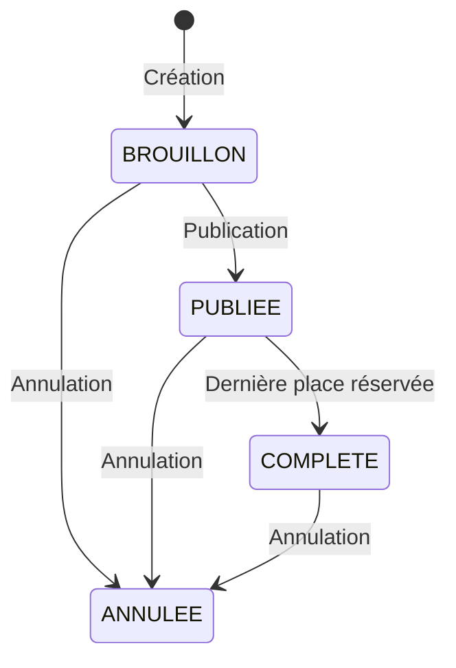

# RoadMoto — organisation de balades moto en Suisse


Plateforme permettant à un motard de proposer une balade et aux autres de s'y inscrire,
avec gestion des places, des états de la sortie et des points d'intérêt géolocalisés.

> 🚧 **Projet en cours de développement.** Le backend (authentification, sorties,
> participations) est fonctionnel et testé. Les itinéraires, l'assistant d'itinéraire
> et le frontend Angular sont en cours. Voir [Feuille de route](#feuille-de-route).

---

## Le problème

Les applications existantes (Kurviger, Calimoto, WeRide) excellent en navigation et en
planification d'itinéraires, mais traitent l'organisation collective en second plan.
Elles ignorent une contrainte propre aux cols de montagnes : leur ouverture. En début
et en fin de saison typiquement d'avril à juin, puis en octobre, savoir quels cols
sont praticables conditionne directement le choix d'un itinéraire, et l'information
est dispersée entre plusieurs sources.

RoadMoto se concentre sur cet angle : **la sortie de groupe**, avec les règles qui vont
avec, et un contexte géographique suisse.

---

## Fonctionnalités

**Implémenté**

- Inscription et authentification par JWT (access token, mots de passe hachés en BCrypt)
- Création d'une sortie : titre, date, point de départ géolocalisé, niveau, places
- Machine à états : `BROUILLON` → `PUBLIEE` → `COMPLETE` / `ANNULEE`
- Inscription avec les règles métier du domaine
- Inscription automatique de l'organisateur à la création
- Calcul des places restantes

**En cours**

- Import des points d'intérêt depuis OpenStreetMap (cols, restaurants, points de vue)
- Calcul d'itinéraires via OpenRouteService
- Assistant d'itinéraire en langage naturel
- Interface Angular avec cartographie
- Désincription à une sortie

---

## Règles métier

Le cœur du projet n'est pas le CRUD mais les invariants du domaine :

| Règle | Comportement |
|---|---|
| Sortie non publiée | Inscription refusée (`409`) |
| Sortie déjà partie | Inscription refusée (`409`) |
| Double inscription | Refusée — vérification applicative **et** contrainte d'unicité en base |
| Dernière place prise | Passage automatique en `COMPLETE` |
| Modification ou publication | Réservée à l'organisateur (`403`) |
| Organisateur | Inscrit d'office, ne peut pas se désister (doit annuler la sortie) |

Chacune fait l'objet d'un test, cas nominal et cas d'erreur.

### Cycle de vie d'une sortie



Ce diagramme représente les principales transitions documentées. Les transitions effectives restent contrôlées par les règles du service métier.

---

## Stack

| Couche | Technologies |
|---|---|
| Backend | Java 21, Spring Boot 3, Spring Security (JWT), Spring Data JPA |
| Base de données | PostgreSQL 17 + PostGIS, migrations Flyway |
| Tests | JUnit 5, AssertJ, Testcontainers |
| Frontend | Angular 20 (standalone, signals), Angular Material, Leaflet *(à venir)* |
| Infrastructure | Docker Compose, GitHub Actions |

---

## Décisions techniques

Les choix ci-dessous sont ceux qui méritent une explication ; le reste suit les
conventions Spring Boot.

**Flyway avec `ddl-auto: validate`, jamais `update`**
Le schéma est du code versionné. Hibernate ne modifie jamais la base : il vérifie que
les entités correspondent au schéma et refuse de démarrer sinon. Cette rigueur a détecté
plusieurs divergences de nommage avant qu'elles n'atteignent la production.

**PostGIS plutôt qu'un calcul de distance applicatif**
Les positions sont stockées en `geography(Point, 4326)` avec un index GIST. Les
recherches par proximité utiliseront `ST_DWithin`, qui exploite l'index là où un calcul
de Haversine en Java imposerait un parcours complet de la table.

**Testcontainers plutôt qu'une base H2**
Les tests s'exécutent contre un vrai PostgreSQL avec PostGIS, la même image qu'en
développement. H2 ne supporte pas les types géographiques et diverge sur les contraintes,
ce qui aurait rendu les tests non représentatifs.

**Défense en profondeur sur les règles d'intégrité**
La vérification de doublon existe à la fois dans le service et comme contrainte
`UNIQUE` en base. Le service produit une erreur métier lisible dans le cas normal ;
la contrainte garantit l'intégrité même en cas d'accès concurrents entre la lecture
et l'écriture.

**Contrôle de capacité sous verrou pessimiste**
La vérification du nombre de places et l'insertion de la participation s'exécutent
sous un verrou `PESSIMISTIC_WRITE` sur la sortie. Deux inscriptions simultanées sur
les dernières places sont ainsi sérialisées, ce qu'un simple contrôle applicatif ne
garantit pas.

**Authentification sans état**
Aucune session serveur : le token porte l'identité. L'API passe ainsi à l'échelle
horizontalement. Contrepartie assumée : un token ne peut pas être révoqué avant son
expiration, d'où une durée de vie courte.

**DTO distincts des entités**
Les entités ne sortent jamais de la couche service. Les DTO de requête excluent les
champs décidés par le serveur (rôle, statut, organisateur), ce qui ferme la porte à
l'élévation de privilèges par le corps de la requête. Les DTO de réponse excluent les
données sensibles, l'organisateur d'une sortie publique est exposé par son pseudo,
jamais par son email.

---

## Lancer le projet en local

**Prérequis** : Java 21, Docker, Maven.

```bash
# 1. Base de données
docker compose up -d

# 2. Application
./mvnw spring-boot:run
```

L'API écoute sur `http://localhost:8081`.
Flyway crée le schéma au premier démarrage.

### Configuration

| Variable | Défaut | Description |
|---|---|---|
| `JWT_SECRET` | clé de développement | Clé de signature HS256, encodée en Base64 |
| `JWT_EXPIRATION_MS` | `86400000` | Durée de validité du token (24 h) |

> La clé présente dans `application.yml` est une clé de développement sans valeur.
> En production, `JWT_SECRET` est fourni par l'environnement.

### Documentation de l'API

Swagger UI : `http://localhost:8081/swagger-ui.html`

---

## Tests

```bash
./mvnw verify
```
### Démonstration

```bash
./mvnw spring-boot:run -Dspring-boot.run.profiles=demo
```

Comptes de test : `marc@demo.ch`, `lea@demo.ch`, `jon@demo.ch` — mot de passe `demo1234`.
Les tests d'intégration démarrent un conteneur PostGIS via Testcontainers —
Docker doit être en cours d'exécution. Aucune base préexistante n'est nécessaire.

La CI exécute la même commande sur chaque pull request.

---

## Limites connues

- Le mapping d'une sortie exécute une requête `COUNT` pour les places restantes.
  Acceptable sur une ressource unique, à optimiser par une requête agrégée sur le
  listing (problème N+1).
- Pas de refresh token : l'utilisateur doit se reconnecter à l'expiration.
- Les fermetures saisonnières des cols sont saisies manuellement, sans source
  officielle automatisée.

---

## Feuille de route

- [x] Authentification JWT et gestion des comptes
- [x] Sorties : création, publication, machine à états
- [x] Participations et règles d'inscription
- [x] Intégration continue
- [ ] Import des POI depuis OpenStreetMap (canton pilote : Valais)
- [ ] Calcul d'itinéraires et mise en cache
- [ ] Assistant d'itinéraire à sortie JSON structurée
- [ ] Interface Angular
- [ ] Déploiement

---

## Ce que je ferais différemment

**Séparer l'authentification de la gestion des comptes dès le départ.** `UtilisateurService`
porte aujourd'hui l'inscription et la délivrance de tokens, deux responsabilités qui
auraient mérité deux services.

**Introduire un UserDetails personnalisé portant l'identifiant.** Chaque requête
authentifiée recharge l'utilisateur depuis la base pour obtenir son id. Un `UserDetails`
métier, combiné à `getReferenceById`, éviterait cet aller-retour.

**Modéliser la machine à états explicitement.** Les transitions sont vérifiées par des
`if` dans le service. Une méthode `peutPasserA(Statut)` sur l'entité rendrait les règles
plus lisibles et testables isolément.

---

## Données et licences

Les données géographiques proviennent d'[OpenStreetMap](https://www.openstreetmap.org/copyright)
(© OpenStreetMap contributors, ODbL). Les fonds de carte proviennent de
[swisstopo](https://www.geo.admin.ch).

Projet de démonstration, développé dans un cadre de portfolio.
